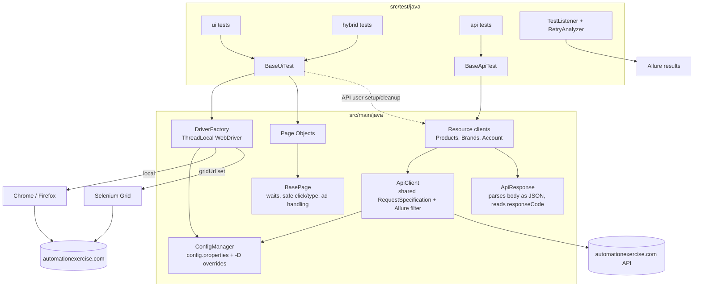

# Java Selenium + REST Assured Hybrid Framework

[](https://github.com/saransh62/java-selenium-restassured-framework/actions/workflows/ci.yml)
[](https://saransh62.github.io/java-selenium-restassured-framework/)

A production-style test automation framework that drives **UI tests (Selenium 4)** and **API tests (REST Assured 5)** from one codebase, and combines them in **hybrid tests** that use the API for fast setup and verification and the browser only for the behaviour under test.

System under test: [automationexercise.com](https://automationexercise.com) and its [public API](https://automationexercise.com/api_list).

## Stack

| Concern | Choice |
|---|---|
| Language / build | Java 17, Maven |
| UI | Selenium 4.52 (Selenium Manager resolves drivers, no WebDriverManager) |
| API | REST Assured 5.5 + JSON Schema Validator, Jackson for POJOs |
| Runner | TestNG 7.12 (parallel by methods, 4 threads) |
| Assertions | AssertJ |
| Reporting | Allure 2 (allure-testng + allure-rest-assured, AspectJ weaver in Surefire) |
| Logging | SLF4J + Logback |
| Infra | Selenium Grid 4 via docker-compose, GitHub Actions, GitHub Pages |

## Architecture



```
src/main/java/com/saransh/automation
├── config/   ConfigManager
├── driver/   DriverFactory (ThreadLocal, local or RemoteWebDriver)
├── pages/    BasePage, HomePage, SignupLoginPage, AccountCreatedPage, ProductsPage,
│             ProductDetailPage, CartPage (+ CartItem), CheckoutPage, ContactUsPage
├── api/      ApiClient, ApiResponse, ProductsClient, BrandsClient, AccountClient, models/
└── utils/    JsonDataReader, TestDataFactory, ScreenshotUtil
src/test/java/com/saransh/automation
├── base/      BaseUiTest, BaseApiTest
├── ui/        HomePageTest, AuthTest, ProductsTest, CartTest, CheckoutTest, ContactUsTest
├── api/       ProductsApiTest, BrandsApiTest, AccountApiTest
├── hybrid/    HybridTest
└── listeners/ TestListener, RetryAnalyzer
src/test/resources  config.properties, testdata/*.json, schemas/*.json, allure.properties, logback.xml
testng.xml  smoke.xml  regression.xml  api.xml  ui.xml
```

## Running

Prerequisites: JDK 17, Maven 3.9+, Chrome and/or Firefox (drivers are downloaded automatically by Selenium Manager).

```bash
mvn test                                   # full suite (testng.xml), headless Chrome, 4 threads
mvn test -Dsuite=smoke.xml                 # smoke group
mvn test -Dsuite=regression.xml            # regression group
mvn test -Dsuite=api.xml                   # API only (no browser)
mvn test -Dsuite=ui.xml                    # UI + hybrid
mvn test -Dtest=CartTest                   # one class
mvn test -Dbrowser=firefox -Dheadless=false
```

Every key in `src/test/resources/config.properties` can be overridden with `-Dkey=value`
(`baseUrl`, `apiBaseUrl`, `browser`, `headless`, `gridUrl`, `explicitWaitSeconds`, `pageLoadTimeoutSeconds`).

### On Selenium Grid

```bash
docker compose up -d                       # hub + Chrome node + Firefox node (UI at http://localhost:4444/ui)
mvn test -DgridUrl=http://localhost:4444 -Dbrowser=chrome
mvn test -DgridUrl=http://localhost:4444 -Dbrowser=firefox
docker compose down
```

### Allure report locally

```bash
mvn allure:serve          # builds and opens the report from target/allure-results
```

### CI

`.github/workflows/ci.yml` runs on every push and pull request:

| Job | What it does |
|---|---|
| `api-tests` | `mvn -Dsuite=api.xml -Dgroups=api test` |
| `ui-tests` | UI + hybrid suite against a `selenium/standalone-chrome` service container, headless |
| `publish-allure-report` | On pushes to `main`: merges both jobs' results, generates the Allure report with history (trends across runs) and publishes it to GitHub Pages |

Allure results from each job are also uploaded as build artifacts.

## Test coverage

| Area | Tests | Notes |
|---|---|---|
| **UI** (17 methods, 21 runs) | home page, subscription (home + cart), register, register with existing email, login valid, login invalid ×3 (JSON data-driven), logout, all products, search ×3 (JSON data-driven), product detail, add to cart, remove from cart, cart quantity, checkout requires login, full checkout to order placement, contact form with file upload | Users needed by UI tests are created through the API |
| **API** (20 methods, 23 runs) | products list, brands list, search (data-driven ×4, no match, missing param), verify login (valid, invalid, missing param), create account (+duplicate), get user by email (+unknown), update account, delete account, unsupported methods (POST productsList, PUT brandsList, DELETE verifyLogin), JSON schema validation (products, brands, error message), cross-check product brands vs brands list | Assertions on the `responseCode` field, not HTTP status |
| **Hybrid** (5) | API create → UI login → header name → API delete; UI register → API read; UI cart vs API catalog; UI search vs API search; API address update → UI checkout | |

Groups: `smoke`, `regression`, `api`, `ui`, `hybrid`.

## Design

See [DESIGN.md](DESIGN.md) for the reasoning behind the main decisions, and [LEARNING.md](LEARNING.md) for a guided code walkthrough and interview questions.

## Assumptions

- **REST Assured 5 / Allure 2** are pinned to their latest 5.x / 2.x releases as the spec asks, even though 6.x / 3.x lines exist.
- **Surefire 3.5.6**, not 3.6.x: Surefire 3.6 runs TestNG on the JUnit Platform and no longer reads TestNG suite XML files, which this framework relies on (`testng.xml`, `smoke.xml`, ...).
- The suite is selected with `-Dsuite=<file>`. CI's API job also passes `-Dgroups=api` as specified; `api.xml` already restricts to that group.
- A `ui.xml` suite (groups `ui` + `hybrid`) was added so the CI UI job doesn't run API tests twice.
- `TestListener` is registered through `META-INF/services` so it applies to every run, including `-Dtest=...` runs that bypass the suite XML, and so it can act as an `IAnnotationTransformer` (needed to attach the retry analyzer to UI tests only).
- The API returns `text/html` with HTTP 200 for everything; tests read the body as JSON and assert on `responseCode`. JSON schema validation runs against the raw body for the same reason.
- Checkout uses a dummy card number; the site is a demo shop and never charges.
- Ads/consent popups are removed from the DOM rather than clicked through, which is more robust against changing ad markup. Page load strategy is `eager` so third-party ad scripts don't slow every navigation.
- Test accounts use `@example.com` addresses and are deleted after each test via the API.
- Grid images are pinned to `4.52.0` to match the Selenium client version.
